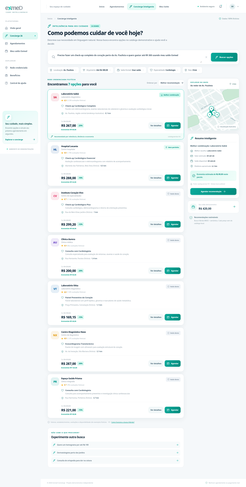
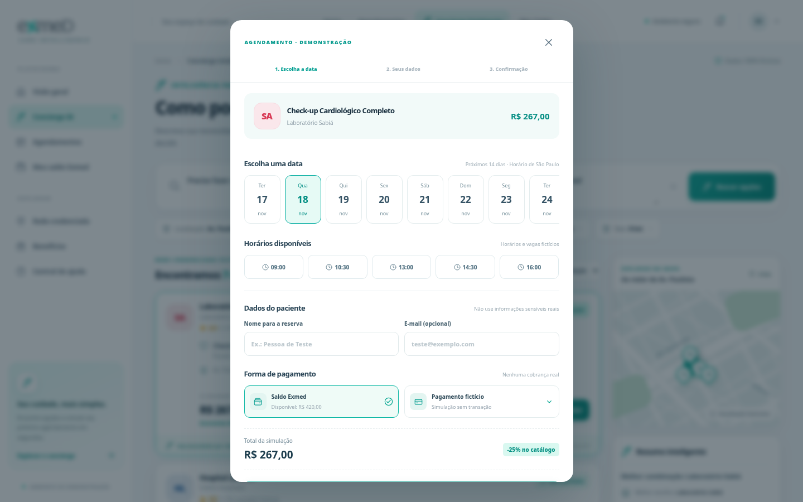

<div align="center">

# Exmed Concierge Inteligente

### Da busca em linguagem natural à simulação de agendamento.

**Uma demonstração full-stack de healthtech, com RAG híbrido real,, catálogo de serviços, comparação inteligente, carteira simulada e reservas persistidas.**

`Python 3.11+` · `FastAPI` · `SQLite` · `BM25 + LSA` · `RRF` · `JavaScript` · `CSS responsivo`

**100% demonstrativo** &nbsp;|&nbsp; ** Evidências rastreáveis** &nbsp;|&nbsp; ** 11 testes automatizados** &nbsp;|&nbsp; ** Sem necessidade de API key**

> Projeto academico com uma empresa real e dados simulados.

</div>

---

##  A experiência

### Desktop — concierge e rede fictícia



<details>
<summary><strong>Ver tela mobile</strong></summary>


</details>

<details>
<summary><strong> Ver a janela de agendamento</strong></summary>



</details>

### O que já funciona

| Módulo | Implementação |
|---|---|
| **Concierge IA** | Pesquisa em português natural com indexação híbrida BM25 + embeddings densos LSA, RRF e expansão de conceitos. |
| **Busca orientada a contexto** | Extrai especialidade, orçamento, região e intenção de usar saldo. |
| **Filtros dinâmicos** | Região, distância máxima, teto de preço, especialidade, saldo e ordenação. |
| **Comparação de serviços** | Ranking por relevância, preço, proximidade ou avaliação fictícia; descontos calculados com precisão de centavos. |
| **Rastreabilidade** | Cada item indica `catalog:service:<id>`; o resumo é baseado em evidências recuperadas. |
| **Mapa ilustrativo** | Exibe os resultados em um mapa estilizado independente de APIs externas; não é cartografia real. |
| **Detalhes do serviço** | Descrição, duração, referência, preço, desconto, estabelecimento fictício. |
| **Agendamento** | Escolha de data, horário e forma de pagamento; gera protocolo e grava a reserva no SQLite. |
| **Controle de conflito** | Bloqueio transacional de reserva duplicada por prestador, dia e horário. |
| **Carteira demo** | Saldo inicial de R$ 420; desconto ao reservar pelo saldo; estorno automático ao cancelar. |
| **Meus agendamentos** | Consulta e cancelamento de reservas, além de histórico. |
| **Navegação completa** | Visão geral, concierge, agenda, saldo, rede de prestadores, benefícios e central de ajuda. |
| **Mobile** | Layout responsivo com navegação inferior, filtros roláveis e modal adaptável. |
| **API de desenvolvimento** | Documentação interativa do FastAPI em `/docs`. |

---

##  Execute em até quatro passos

### Windows + VS Code + Git Bash — recomendado

**Pré-requisito:** Python **3.11, 3.12 ou 3.13** instalado. Na instalação, habilite **Add Python to PATH**. Git Bash e VS Code são opcionais, mas recomendados.

1. **Extraia o arquivo ZIP** e abra no VS Code a pasta que contém este `README.md` e o arquivo `requirements.txt`.
2. Abra o terminal do VS Code em **Git Bash** e confira seu Python:

   ```bash
   py -0p
   python --version
   ```

3. **Crie o ambiente e instale as dependências:**

   ```bash
   python -m venv .venv
   source .venv/Scripts/activate
   python -m pip install --upgrade pip
   python -m pip install -r requirements.txt
   ```

4. **Inicie a plataforma:**

   ```bash
   python -m uvicorn app.main:app --reload --host 127.0.0.1 --port 8000
   ```

Acesse no navegador:

| Endereço | Descrição |
|---|---|
| **http://127.0.0.1:8000** | Interface completa |
| **http://127.0.0.1:8000/docs** | API interativa (Swagger) |
| **http://127.0.0.1:8000/api/health** | Estado do backend |

**Alternativa sem terminal:** no Windows, dê dois cliques em **`start.bat`**. Ele cria a `.venv` (se ainda não existir), instala as dependências e sobe o servidor. Depois abra a URL exibida.

> **Importante:** você deve executar os comandos **na pasta extraída que contém `requirements.txt`**. É desnecessário instalar Node.js, React, Vite, Streamlit, Docker ou baixar modelos de IA. O app roda com **um único servidor Python**.

### macOS / Linux

```bash
python3 -m venv .venv
source .venv/bin/activate
python -m pip install -r requirements.txt
python -m uvicorn app.main:app --reload
```

### Primeiro uso

O banco de dados é criado automaticamente em `data/exmed_demo.sqlite3` na primeira inicialização. O sistema importa **7 parceiros fictícios e 16 serviços** a partir de `app/data/seed_catalog.json`. O usuário não precisa configurar nada.

**Buscas para testar:**

- `Preciso fazer um check-up completo do coração perto da Av. Paulista e quero gastar até R$ 300 usando meu saldo Exmed`
- `Quero um hemograma por até R$ 100`
- `Dermatologista perto dos Jardins`
- `Consulta de ortopedia para dor na coluna`

Faça uma busca, clique em **Agendar**, escolha um dia e horário livre, informe um nome fictício e confirme. Em **Agendamentos**, veja a reserva persistida, cancele e verifique o estorno do saldo.

---

##  Arquitetura do RAG híbrido

O projeto não simula um RAG apenas mudando palavras na interface. Ele constrói **dois índices de recuperação sobre o catálogo**, combina os resultados e fundamenta a resposta nos registros consultados.


### 1. Corpus e indexação

A fonte de verdade é o catálogo SQLite (`providers` e `services`). Cada documento indexado une:

`nome do serviço + especialidade + descrição + sinônimos + tipo do parceiro + região + nome do parceiro`

A indexação é feita **no startup** pelo serviço `HybridRAG` (`app/rag.py`). O catálogo é pequeno para que essa etapa seja rápida e totalmente local.

### 2. Recuperação lexical: BM25

O BM25 pontua termos relevantes do pedido, levando em conta frequência no documento, tamanho do documento e raridade da palavra no catálogo. É útil quando a pessoa conhece a nomenclatura exata, como *hemograma* ou *ecocardiograma*.

### 3. Recuperação densa: LSA

Para a segunda visão, a aplicação calcula vetores TF-IDF (incluindo *bigrams*) e aplica **Latent Semantic Analysis** com `TruncatedSVD`. A similaridade é calculada por **cosseno** entre vetores normalizados.

Esta é uma implementação real de **representações semânticas densas e busca vetorial local**, não apenas comparação de strings. Entretanto, **LSA não é um transformer** e sua capacidade semântica é limitada pelo tamanho do catálogo. Para operação em larga escala, substituir por embeddings multilíngues médicos (com validação) e um banco vetorial como pgvector é o caminho natural.

### 4. Combinação por RRF e restrições

Os rankings lexical e denso são fundidos por Reciprocal Rank Fusion:

\[
\operatorname{RRF}(d) = \frac{1}{60 + r_{BM25}(d)} + \frac{1}{60 + r_{LSA}(d)}
\]

Depois, um critério determinístico aplica orçamento máximo, especialidade solicitada, distância calculada por **Haversine**, proximidade, desconto e adequação a um pedido de *check-up*. Ordenações explícitas são respeitadas.

### 5. Resposta fundamentada: geração e fontes

O resumo contém apenas informações dos serviços recuperados (`source_id`, preço, desconto, distância e parceiro). **Preço, desconto, saldo e disponibilidade são calculados no backend e nunca delegados à geração de texto.**

- **Sem chave externa:** síntese determinística, auditável e completamente funcional, a partir das evidências recuperadas.
- **Com `OPENAI_API_KEY`:** o backend envia ao LLM somente a intenção e as evidências resumidas, exigindo uma resposta curta limitada às fontes. Se a integração não responder, utiliza automaticamente a síntese local.

> Um resumo produzido por LLM ainda pode conter imprecisões. Em produção, complemente com validação estruturada das afirmações, proteção contra injeção de prompt, auditoria e revisão humana onde necessário. Este protótipo **não oferece garantias de zero alucinação**.

---

## Estrutura do repositório

```text
exmed-concierge-inteligente/
├── app/
│   ├── __init__.py
│   ├── main.py                 # FastAPI, endpoints e transações de reserva
│   ├── rag.py                  # BM25, LSA, RRF, interpretação e síntese
│   ├── database.py             # SQLite, esquema, carga e consultas
│   └── data/
│       └── seed_catalog.json  # 7 parceiros e 16 serviços DEMONSTRATIVOS
├── frontend/
│   ├── index.html              # Estrutura da interface, ícones SVG
│   └── assets/
│       ├── app.js              # Busca, filtros, navegação e agendamento
│       ├── styles.css          # Design system e responsividade
│       └── favicon.svg
├── tests/
│   ├── conftest.py             # Banco temporário para testes
│   └── test_api.py             # 9 testes de integração
├── docs/
│   ├── ARQUITETURA.md          # Visão técnica e evolução para produção
│   ├── API.md                  # Contratos e exemplos HTTP
│   ├── preview-desktop.png
│   ├── preview-mobile.png
│   └── preview-agendamento.png
├── .env.example                # Referência de configurações opcionais
├── .gitignore                  # Exclui banco, credenciais e venv
├── requirements.txt
├── requirements-dev.txt
├── start.bat                   # Inicialização simplificada no Windows
├── start.sh                    # Inicialização simplificada Unix/Git Bash
└── README.md
```

**Sem `node_modules`, sem build, sem empacotador.** O frontend utiliza JavaScript moderno e CSS nativo; o FastAPI serve API e arquivos estáticos na mesma origem, sem dependência de CORS ou de dois servidores em paralelo.

---

## 🔌 API — visão geral

A documentação interativa fica em **`/docs`** enquanto o servidor está ativo.

| Método | Endpoint | Finalidade |
|---|---|---|
| `GET` | `/api/health` | Saúde do backend e identificação do RAG |
| `GET` | `/api/bootstrap` | Catálogo resumido, filtros e carteira |
| `POST` | `/api/search` | Busca RAG híbrida e síntese com evidências |
| `GET` | `/api/services/{id}` | Serviço completo e fonte |
| `GET` | `/api/providers` | Parceiros fictícios |
| `GET` | `/api/providers/{id}/services` | Serviços de um parceiro |
| `GET` | `/api/slots?service_id=101&day=AAAA-MM-DD` | Horários disponíveis por prestador |
| `POST` | `/api/appointments` | Confirma reserva de demonstração |
| `GET` | `/api/appointments` | Lista reservas e cancelamentos |
| `POST` | `/api/appointments/{id}/cancel` | Cancela e estorna carteira |
| `GET` | `/api/wallet` | Consulta saldo demonstrativo |

### Exemplo de busca

```bash
curl -X POST http://127.0.0.1:8000/api/search \
  -H 'Content-Type: application/json' \
  -d '{"query":"check-up do coração até R$ 300 na Paulista usando saldo","sort":"recommended"}'
```

O retorno contém `results`, `intent`, `summary`, `count`, `retrieval_method` e `demo`. Cada resultado inclui `retrieval.bm25`, `retrieval.semantic_similarity`, `retrieval.rrf` e `source_id`.

Para exemplos de requisições e respostas, veja [docs/API.md](docs/API.md).

---

## 🧪 Testes e verificações

Instale as dependências de desenvolvimento:

```bash
python -m pip install -r requirements-dev.txt
python -m pytest -q
```

Os 11 testes cobrem saúde da API, indexação e busca híbrida, detecção de especialidade, teto de preço, ordenação, ausência de resultados, criação de reservas, conflito de horário, saldo insuficiente, pagamento fictício, cancelamento, estorno, validação e entrega do frontend.

**Verificações locais realizadas na entrega:** `python -m pytest -q` (**11 passed**), compilação dos módulos Python, verificação de sintaxe JavaScript e renderização visual responsiva do frontend.

---

## ⚙️ Configuração opcional de LLM

O RAG híbrido **não depende de um LLM externo** para buscar e ranquear serviços. Caso queira complementar a síntese local com geração textual:

**PowerShell (somente para a sessão atual):**

```powershell
$env:OPENAI_API_KEY="sua-chave-aqui"
$env:OPENAI_MODEL="gpt-4.1-mini"
python -m uvicorn app.main:app --reload
```

**Git Bash (somente para a sessão atual):**

```bash
export OPENAI_API_KEY="sua-chave-aqui"
export OPENAI_MODEL="gpt-4.1-mini"
python -m uvicorn app.main:app --reload
```

A aplicação utiliza `OPENAI_API_KEY` somente no servidor; **não coloca sua chave no JavaScript, no HTML ou no banco**. Não existe dependência direta do SDK da OpenAI: a chamada é feita por HTTPS usando a biblioteca padrão do Python. Se a chave for inválida, houver queda de rede ou a API estiver indisponível, a síntese local continua disponível.

O arquivo `.env.example` é apenas uma referência. Este projeto não carrega automaticamente variáveis de um arquivo `.env` — exporte-as na sessão ou use o gerenciador de ambiente da sua preferência.

---

## Segurança, dados e limites da demonstração

- **Nenhuma reserva é enviada a clínicas.** Horários existem somente na base local.
- **Sem pagamento real.** O botão de pagamento fictício não integra cartão, Pix ou gateway.
- **Sem autenticação.** A aplicação foi deliberadamente projetada como demonstração local; não é apropriada para exposição pública sem implementar autenticação, autorização e isolamento por usuário.
- **Evite dados pessoais reais.** Nome e e-mail da reserva são campos demonstrativos armazenados no SQLite local. A interface não solicita CPF, documento, histórico médico ou cartão.
- **Preço e avaliações são fictícios.** O mapa é ilustrativo e as coordenadas são apenas referências da região.
- **Sem aconselhamento médico.** A pesquisa identifica entradas de catálogo; não interpreta sintomas de maneira clínica nem substitui profissional habilitado.
- **Configurações sensíveis ficam fora do Git.** `.gitignore` exclui `.env`, bancos locais, `.venv` e caches.
- **Persistência:** a reserva sobrevive a reinicializações do servidor no mesmo computador, pois é gravada no SQLite. Não há sincronização com outros usuários em produção.

Para reiniciar **apenas os dados fictícios**, desligue o servidor e apague o arquivo `data/exmed_demo.sqlite3`. Ele será reconstruído com o catálogo e saldo inicial no próximo startup. Isso também apaga o histórico de testes.

### Próximos passos para uma versão de produção

A transição exigiria, entre outros: autenticação e autorização por perfil, criptografia/segredos gerenciados, política LGPD e minimização de dados, regras de consentimento, logs auditáveis, integração autorizada com rede e agenda reais, disponibilidade transacional distribuída, banco PostgreSQL, observabilidade, rate limiting, embeddings validados para terminologia médica e proteção reforçada contra alucinações.

---

##  Por que esta stack?

**FastAPI + SQLite + JavaScript nativo** reduz atrito para rodar no Windows e mantém a plataforma funcional sem instalar Node ou montar dois serviços. **BM25 + LSA + RRF** entrega recuperação híbrida verificável, offline, fácil de estudar e adaptar. O design prioriza consistência de cores, hierarquia tipográfica, acessibilidade básica, feedback de ações, fluxo mobile e rapidez de navegação.

**A proposta deste repositório é demonstrar produto e engenharia, não simular integração comercial existente.**

---

<div align="center">

**Feito para demonstrar uma jornada de cuidado mais simples, transparente e inteligente.**

`Exmed Concierge Inteligente · Projeto fictício de portfólio · 2026`

</div>
